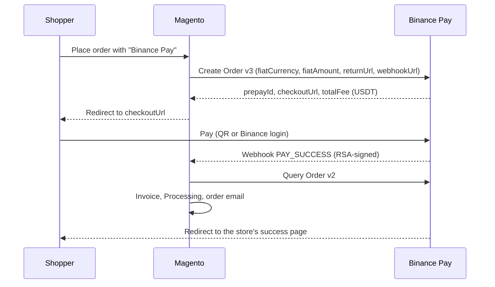

# Binance Pay Payment Gateway for Magento 2 (Adobe Commerce)

**Magento 2 Binance Pay** is an open-source payment gateway extension that lets a Magento 2 / Adobe Commerce 2.4
store **accept USDT, USDC, BTC, BNB and other crypto through Binance Pay**, using the official Binance Pay Merchant
API v3. Prices stay in your store currency (USD, EUR, CAD, VND and the other fiat currencies Binance supports);
Binance converts the amount, the shopper pays on the Binance hosted checkout (QR code on desktop, Binance app on
mobile), and the order is invoiced automatically once Binance confirms the payment.

**Setting it up for the first time?** The [step-by-step setup guide](docs/setup-guide.md) walks a store owner
through it with screenshots and a 2-minute video: where to get the API key, where to paste it in Magento, a $1 test
order with a refund, and what shoppers see.

| Shopper: pay with Binance Pay | Merchant: order details and online refund |
| --- | --- |
|  |  |

<sub>Recorded on Magento 2.4.8-p2 (Luma) against the bundled Binance Pay mock server, so no real funds moved. The real
Binance checkout page looks different. MP4 versions: [checkout](docs/binance-pay-checkout.mp4),
[refund](docs/binance-pay-admin-refund.mp4).</sub>

## Features

- **Binance Pay hosted checkout**: QR code for the Binance app, or log in to Binance on the web.
- **Priced in your store currency**: the order is created in the order currency (`fiatCurrency` + `fiatAmount`);
  Binance quotes it in USDT or USDC and the shopper can pay with any coin Binance accepts.
- **Automatic invoicing**: a paid order moves from *Pending Payment* to *Processing* with an invoice and the order
  email, whether the shopper comes back to the store or closes the browser.
- **Signed webhooks**: every notification is checked against Binance's RSA public key (Query Certificate API), then
  the order status is read back from Binance, so a forged or replayed call cannot mark an order paid.
- **Safety net**: a cron job re-checks pending Binance Pay orders every 5 minutes in case a webhook was missed, and
  cancels the ones that expired.
- **Online refunds**: full and partial refunds from a credit memo (*Refund* button on the invoice). The refund is
  converted to the same share of the crypto total; the last refund sends the exact remainder.
- **Amount check**: if Binance reports another amount or currency than the one requested, the order is put on hold
  for a person to review instead of being invoiced.
- **Cancel and retry**: a shopper who cancels on Binance goes back to the cart with the items restored; the Binance
  order is closed and the Magento order cancelled.
- Credentials per website, country and order-total restrictions, debug log, Magento coding standard clean.

## How it works



| Binance status | Magento order |
| --- | --- |
| `INITIAL`, `PENDING` | stays *Pending Payment* |
| `PAID` (amount and currency match) | invoiced, *Processing*, order email sent |
| `PAID` (amount or currency differ) | *On Hold* with a comment |
| `CANCELED`, `EXPIRED`, `ERROR` | *Canceled* |
| `REFUNDING`, `REFUNDED` on an order Magento never invoiced | *On Hold* with a comment |

## Requirements

- Magento Open Source or Adobe Commerce 2.4.x, PHP 8.1 to 8.4 with `bcmath`, `openssl` and `json`.
  Tested on Magento 2.4.8-p2 with PHP 8.3.
- A Binance merchant account with Binance Pay and an API key: log in to the
  [Binance Merchant Admin Portal](https://merchant.binance.com/en) and create an API identity key and secret. Copy
  the secret when it is shown; it is hashed afterwards. If you fill in *IP Access Restrictions* there, add your
  server's outgoing IP.
- The Luma checkout (also used by Hyvä themes through the Luma checkout fallback). Hyvä Checkout (Magewire) needs a
  separate compatibility module, which is not included.

## Installation

Composer, from this repository:

```bash
composer config repositories.joepham-binance-pay vcs https://github.com/ph4mHoa/magento2-binance-pay
composer require joepham/module-binance-pay:dev-main
bin/magento module:enable JoePham_BinancePay
bin/magento setup:upgrade
bin/magento setup:di:compile            # production mode
bin/magento setup:static-content:deploy # production mode
bin/magento cache:flush
```

Or copy the files to `app/code/JoePham/BinancePay` and run the same `bin/magento` commands.

## Configuration

**Stores > Configuration > Sales > Payment Methods > Binance Pay**

| Setting | Notes |
| --- | --- |
| Enabled | Show Binance Pay at checkout. |
| Title | Name shown at checkout, e.g. "Binance Pay (USDT, USDC, BTC)". |
| API Key / API Secret | From the Binance Merchant Admin Portal. Stored encrypted. |
| Order Number Prefix | Letters and digits put before the order number in the Binance order number. Use a different prefix per environment when staging and production share one merchant account. |
| Payment from Applicable Countries | All, or a list of countries. |
| Minimum / Maximum Order Total | Optional limits. |
| Debug | Logs API requests and responses to `var/log/joepham_binancepay.log`. |
| API Base URL | Leave as `https://bpay.binanceapi.com`; change only to point at the test mock. |

Nothing has to be set in the Binance portal for webhooks: each order and refund request carries the store's
webhook URL (`https://<store>/joepham_binancepay/webhook`), which takes precedence over the one in the portal. The
URL must be reachable from the internet over HTTPS. Binance limits the order number to 32 letters and digits, so
the prefix plus the order increment ID must fit in 32 characters.

## Refunds

Open the order, go to **Invoices**, open the invoice and click **Credit Memo**, then **Refund**. Magento asks Binance to
refund the matching share of the crypto amount (for example, refunding $40 of a $100 order paid with 25 USDT sends
10 USDT back). Binance confirms with a `PAY_REFUND` webhook, which is added to the order comments; a rejected refund
is flagged there too so you can refund the customer by hand. *Refund Offline* only records the credit memo in
Magento.

## Testing without a Binance account

Binance Pay has no public sandbox for the Merchant API, so the module ships a mock server that behaves like it: it
checks the HMAC-SHA512 request signatures, keeps orders, serves a test checkout page and sends RSA-signed webhooks.
Before going live, also pay one small real order and refund it, as described in the
[setup guide](docs/setup-guide.md#4-test-with-a-small-real-order-and-a-refund).

```bash
# 1. Start the mock (it needs several workers: Magento calls back while handling a webhook)
MOCK_API_KEY=mock-key MOCK_API_SECRET=mock-secret MOCK_WEBHOOK_INSECURE=1 PHP_CLI_SERVER_WORKERS=4 \
    php -S 127.0.0.1:8701 app/code/JoePham/BinancePay/Test/Mock/binance-pay-mock.php

# 2. Point a development store at it
bin/magento config:set payment/joepham_binancepay/api_url http://127.0.0.1:8701
bin/magento config:set payment/joepham_binancepay/api_key mock-key
bin/magento config:set payment/joepham_binancepay/api_secret mock-secret
bin/magento config:set payment/joepham_binancepay/active 1
bin/magento cache:flush

# 3. Unit tests
vendor/bin/phpunit -c dev/tests/unit/phpunit.xml.dist app/code/JoePham/BinancePay/Test/Unit

# 4. End-to-end checkout (Playwright for Python): pay, cancel, webhook only, wrong amount, admin refund
python3 app/code/JoePham/BinancePay/Test/E2E/binance_pay_e2e.py --base https://magento.test \
    --magento-root "$PWD" --product joust-duffle-bag.html --admin-user <admin> --admin-password <password>
```

The mock's `/mock/state` endpoint shows the orders, refunds and webhook deliveries. Never point a live store at it.

## Troubleshooting

- **Error 400002 (Incorrect signature)**: the API secret is wrong, or was copied after Binance hashed it.
- **Error 400004**: the API key is wrong, or the server IP is not in the portal's IP Access Restrictions.
- **Order stays Pending Payment**: check that `https://<store>/joepham_binancepay/webhook` is reachable from the
  internet and that Magento cron runs; enable Debug and read `var/log/joepham_binancepay.log`.
- **"Order number cannot be used as a Binance Pay order number"**: the prefix plus increment ID is longer than 32
  characters.

## Related

- [OKX Crypto Payment Gateway for Magento 2](https://github.com/ph4mHoa/magento2-okx-pay): accept USDT from the OKX
  app or OKX Wallet on X Layer.

## License

[MIT](LICENSE)

*This is an independent open-source project and is not affiliated with, endorsed by or sponsored by Binance or
Adobe. "Binance", "Binance Pay", "Magento" and "Adobe Commerce" are trademarks of their respective owners.*
