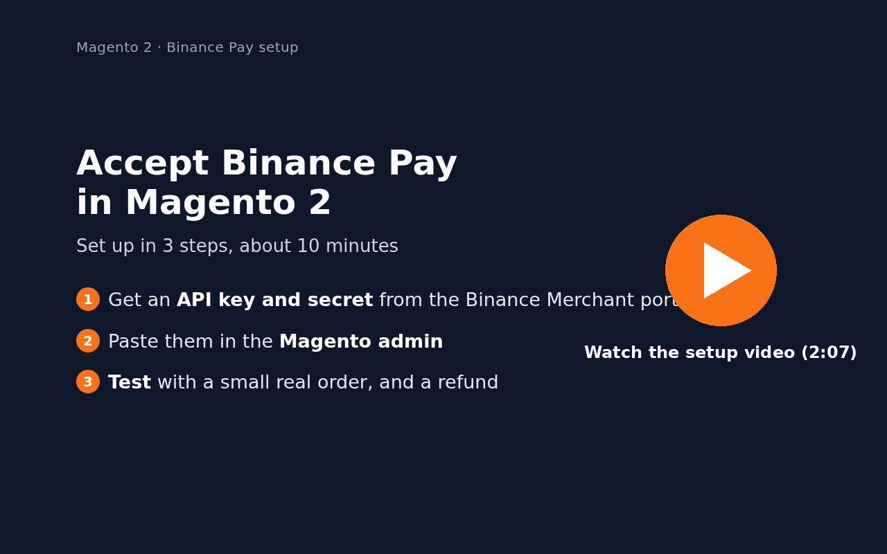
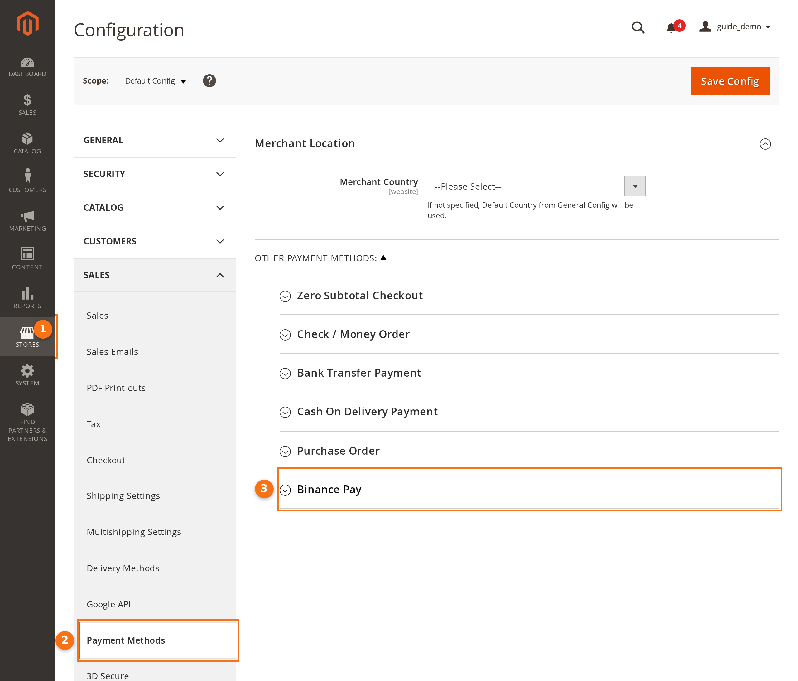
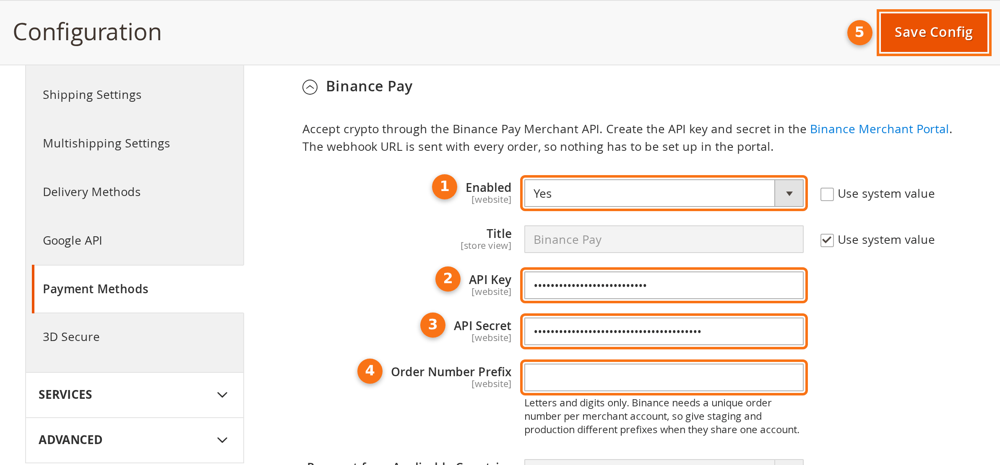

# Set up Binance Pay in Magento 2: step-by-step guide

This guide is for store owners and needs no coding. It shows where to get your Binance Pay API key, where to paste it
in Magento, how to check everything with a $1 order and a refund, and what your shoppers see. Your developer installs
the extension first ([installation](../README.md#installation)).

The video and screenshots were made on a test store connected to the extension's test server, so no real money
moved. Binance's real payment page looks different from the test one.

1. [What you need](#1-what-you-need)
2. [Create an API key](#2-create-an-api-key-in-the-binance-merchant-portal)
3. [Settings in Magento](#3-settings-in-magento)
4. [Test with a small real order](#4-test-with-a-small-real-order-and-a-refund)
5. [What your shoppers see](#5-what-your-shoppers-see)
6. [Everyday use](#6-everyday-use)

## 1. What you need

- **A Binance Pay merchant account, which needs a registered business.** Binance takes merchants only through a
  Binance *entity* (company) account, not a personal one, and an email already used for a personal account cannot be
  used for it. Sign up as an entity and complete the entity verification with your company documents, then apply as
  a *Direct Merchant* in the [Binance Merchant portal](https://merchant.binance.com/en/onboarding) and sign the
  Binance Pay agreement there. Binance reviews the application before you can take payments
  ([Binance FAQ: How to apply for Binance Pay merchant](https://www.binance.com/en/support/faq/how-to-apply-for-binance-pay-merchant-7a49148912214defa816f14ee51b9f9f)).
- **Your store online over HTTPS.** Binance tells your store about each payment at
  `https://<your store>/joepham_binancepay/webhook`, so the store must be reachable from the internet. A store that
  runs only on your own computer will not receive these messages.
- **Magento cron running** (ask your developer or host). It re-checks unpaid Binance Pay orders every 5 minutes, in
  case a message from Binance was missed.

## 2. Create an API key in the Binance Merchant portal

1. Log in to the [Binance Merchant Admin Portal](https://merchant.binance.com/en).
2. Open the API key page in the developer settings and create a new API key.
3. Copy the **API key** and the **secret key** straight away to a safe place, such as a password manager. Binance
   shows the secret only when it is created: after a refresh it is shown hashed, and the hashed value does not work
   ([Binance Pay FAQ](https://developers.binance.com/en/docs/products/binance-pay-merchant/fap)).
4. Optional: in **IP Access Restrictions**, enter your server's outgoing IP address (ask your developer). Leave it
   empty if you are not sure: a wrong address blocks every payment (Binance error 400004).

Nothing else has to be set in the portal. The extension sends its notification address with every order.

Menu names in the portal can change; if you cannot find the API key page, ask Binance Merchant support.

## 3. Settings in Magento

In the Magento admin, go to **Stores › Configuration**, then **Sales › Payment Methods**. Binance Pay is near the
bottom, under *Other Payment Methods*.

Open **Binance Pay** and fill in:

| # | Setting | What to do |
| --- | --- | --- |
| 1 | Enabled | Untick *Use system value*, then choose **Yes**. |
| 2 | API Key | The API key from section 2. Magento stores it encrypted. |
| 3 | API Secret | The secret key from section 2. Magento stores it encrypted. |
| 4 | Order Number Prefix | Optional, letters and digits only. If a test copy of your store uses the same merchant account, give each copy its own prefix. |
| 5 | Save Config | The orange button at the top right. |

Further down, all optional: countries, minimum or maximum order total, and *Debug*. Leave *API Base URL* as it is.

Then open your store in a private browser window, add a product to the cart and go to checkout: Binance Pay is listed
with the other payment methods. If it is missing, check the countries and the order total limits.

## 4. Test with a small real order (and a refund)

Do this once before you tell customers. Your merchant account receives the money, so pay from **another Binance
account** (a colleague's, for example).

1. **Make a $1 test product.** Go to *Catalog › Products › Add Product › Virtual Product*. Name it "Payment test",
   set the price to `1`, the quantity to `10` and *Stock Status* to *In Stock*, then save. A virtual product needs no
   shipping, so the order total stays at $1. A new product can show *Out of stock* for a minute, until Magento has
   updated its indexes.
2. **Order it.** In a private browser window, add the product to the cart, check out, choose **Binance Pay** and
   click **Place Order**. Binance's payment page opens.
3. **Pay.** On a computer, scan the QR code with the Binance app of the other account; on a phone, continue in the
   Binance app. Confirm the payment and enter the payment PIN.
4. **Check the result.** You come back to the store's "Thank you" page. In *Sales › Orders* the order is
   **Processing** (a virtual product goes straight to **Complete**). It has an invoice, and the order page shows what
   Binance received.
5. **Test a refund.** Open the order, go to **Invoices**, open the invoice, click **Credit Memo**, then **Refund**.
   Binance sends the money back to the account that paid, and confirms it in the order comments shortly after.
   *Refund Offline* would only record the refund in Magento, without sending money.
6. **Tidy up.** Disable the test product.

If the order stays *Pending Payment*, see [Troubleshooting](../README.md#troubleshooting).

## 5. What your shoppers see

1. At checkout, the shopper chooses **Binance Pay** and clicks **Place Order**.
2. Binance's payment page opens with the amount, converted by Binance from your store's price, and a QR code. On a
   phone, the shopper can go straight to the Binance app.
3. The shopper pays in the Binance app: scan, confirm, payment PIN. They can pay with any coin Binance accepts.
4. They come back to your store's "Thank you" page and receive the order email.

A shopper who cancels on the Binance page goes back to the cart, with the items still in it.

The whole flow, recorded on the test store: [checkout](binance-pay-checkout.gif) and
[refund from the admin](binance-pay-admin-refund.gif).

## 6. Everyday use

| In *Sales › Orders* | Meaning | What to do |
| --- | --- | --- |
| *Pending Payment* | Waiting for the shopper to pay on Binance | Nothing |
| *Processing* or *Complete*, with an invoice | Paid | Ship as usual |
| *On Hold*, with a comment | Binance reported a different amount or currency than requested | Check the payment in the Binance Merchant portal before you ship |
| *Canceled* | Cancelled by the shopper, or the payment expired | Nothing |

- **Refunds** go through Binance: credit memo from the invoice, full or partial, as in step 5 of section 4.
- **If your API secret leaks**, delete the key in the Binance Merchant portal, create a new one and paste it in
  Magento.

More answers: [Troubleshooting](../README.md#troubleshooting).
